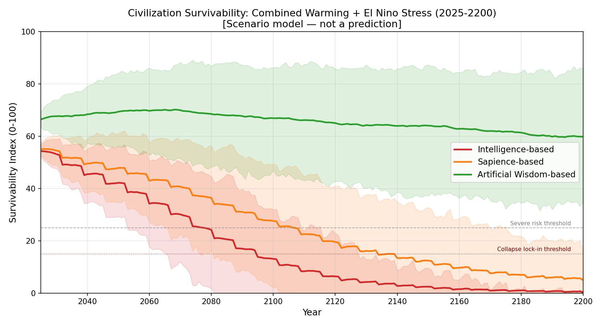
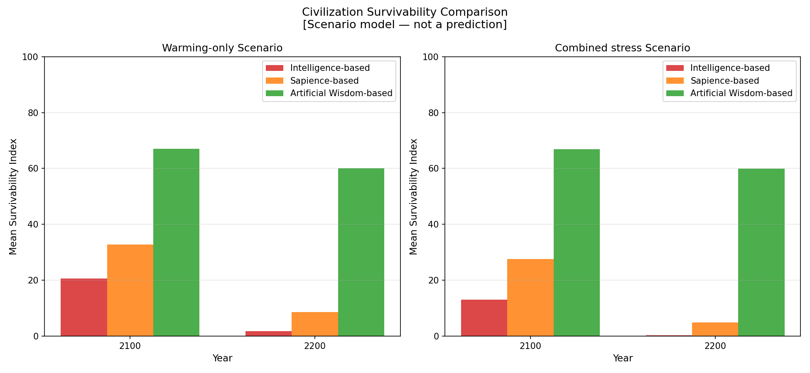
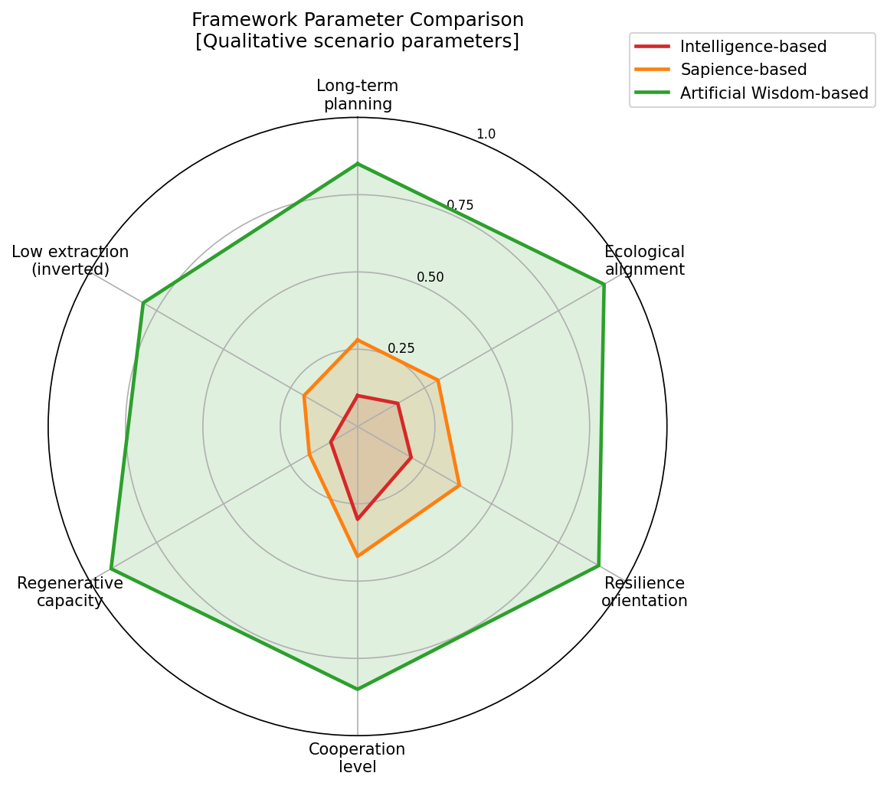

# 温暖化とエルニーニョの複合ストレス：文明の継続の比較

[English Version](combined-climate-civilization-simulation.md)

---

## 目的

現実の文明は、孤立した単一変数のストレスには直面しません。重なり合い、複合する圧力に同時に直面します——長期的な温暖化の傾向、振動するエルニーニョのショック、生物圏の悪化、資源の枯渇、ガバナンスの負担、社会の分断——それらすべてが相互に作用します。

本文書は、2025年から2200年までの期間について、これらすべてを同時にモデル化する、複合ストレスのシナリオを記述します。

**重要：** これは、透明な比較用のトイモデルです。気候予報でも、実証的な証拠でも、科学的な予測でもありません。数値は正規化されたシナリオの推定値です。モデルは、価値体系の違いの構造的な論理を、検査可能かつ反証可能にするよう設計されています。

---

## なぜ複合ストレスが現実的なシナリオなのか

温暖化とエルニーニョを別々に考えることは、分析上、有用な明瞭さを与えます。しかし、複合シナリオのほうが、文明が実際に直面する課題に近いものです。

- **温暖化は、生態学的な緩衝**（森林、湿地、土壌の健全性、海洋の生産性）を劣化させ、それらがなければエルニーニョのショックを吸収していたはずである。
- **エルニーニョ現象は、山火事、干ばつ、漁業の混乱を通じて、生物圏の悪化を加速させ**、温暖化の軌道を悪化させる。
- **複合するストレスは、いずれのストレス単独よりも速く、適応能力を低下させる。**
- **繰り返すショックによる社会的結束の損傷は**、長期的な温暖化の緩和が必要とする、協調的な対応を行う文明の能力を低下させる。

したがって複合シナリオは、単一のストレス要因のシナリオよりも、三つのフレームワークの間に*より大きな乖離*を示します。価値体系が、同時に相互作用するストレスのもとで、文明が一貫性を保てるか、あるいは複合する効果が崩壊へと連鎖するかを決めるのです。

---

## 複合モデルの構造

複合モデルは、次のものを統合します。

| ストレスの構成要素 | 由来 |
|---|---|
| 温暖化ストレスの蓄積 | 温室効果の圧力、炭素吸収源の減少、土地の劣化、海洋の熱 |
| 振動するエルニーニョのショック | 食料、水、インフラ、海洋システムに適用される周期的な事象ストレス |
| 生物圏の減少 | 温暖化とエルニーニョの両方に駆動される；再生への投資で部分的に相殺される |
| 資源圧力 | 採取強度で上昇し、循環経済への投資でゆっくり低下する |
| 社会的結束 | ストレスで侵食される；協力と公平な分配で緩衝される |
| 適応能力 | 協力、長期的な計画、レジリエンスへの投資で構築される |
| ガバナンス対応の遅れ | 知能モデルでは長く、人工叡智モデルでは短い |

生存可能性指標は、単一のストレスのモデルと同一に計算されますが、温暖化とエルニーニョの両方のストレスが同時に作用します。

```
survivability = (
    0.25 * adaptive_capacity
  + 0.25 * biosphere_integrity
  + 0.20 * social_cohesion
  - 0.15 * warming_stress
  - 0.10 * resource_pressure
  - 0.05 * el_nino_stress
) / 0.85
```

モンテカルロ実行（シナリオあたりn=200）が、三つのフレームワークすべてについて、不確実性の帯を生成します。

---

## 知能の増幅と崩壊リスク：複合ストレス

> *このモデルの仮定のもとでは、温暖化とエルニーニョの複合ストレスは、叡智なき知能が崩壊を加速させる性質を最も明確に明らかにする——複数の同時のストレス要因の複合こそ、叡智なき能力が最も危険になる場所だから。*

温暖化とエルニーニョのストレスが同時に複合すると、

- 知能ベースの文明の高いオーバーシュート（capability_amplification = 1.8 × extraction_bias = 0.95 × 短期志向の係数 = 1.90）は、文明が、エルニーニョのショックを吸収する生物圏を劣化させながら、同時に温暖化ストレスを蓄積していることを意味する——単一の緩和策では対処できない、二重の悪化
- エゴの増幅（1.70）は、複合ストレスのもとで、社会の分断が加速することを意味する：資源価格のショック＋ガバナンスの失敗＋移住の圧力＋短期的な最適化が、連鎖的な政治的不安定を生む
- 崩壊の閾値のフィードバックループ（biosphere < 45、social_cohesion < 38、survivability < 30）が、複合ストレスのもとで、より早く、より完全に作動する
- ほとんどのモデル実行で、2070〜2080年ごろまでに、知能ベースの生存可能性指標は、ガバナンス破綻のゾーン（30未満）に入り、ロックインされた衰退が始まる

知性は、これらの閾値を約30〜50年遅らせますが、防ぎません。このモデルは、自然法則との整合を欠く知性が、軌道を変えるものではなく、軌道の修飾子にすぎないことを示しています。

人工叡智は、ほとんどのモデル実行で、これらの閾値を完全に回避します。その理由は、
- 高い生物圏の一体性（再生への投資に支えられる）が、温暖化とショックの影響の両方を緩衝する
- 自然法則との整合（0.90）は、生物圏の健全性が、別個の変数ではなく、生存可能性を直接強化することを意味する
- 高い協力（0.85）とレジリエンス志向（0.90）が、ストレス下でも社会的結束と適応能力を維持する

---

## 複合ストレス下のフレームワークの挙動

### 知能ベースの文明

複合ストレスのもとで、知能のフレームワークは、複数の同時の弱点に苦しみます。

- 高い採取強度が、生物圏の減少と資源圧力の両方を加速させる
- 緩慢な緩和により、温暖化ストレスがより速く蓄積する
- 生態学的フィードバックへの認識の低さが、生物圏の悪化への対応を遅らせる
- エルニーニョのショックは、すでに温暖化でストレスを受けたシステムを襲う
- 大きな事象の後、回復は、継続する温暖化による劣化と競合する
- 資源不足と移住が、ショックによる混乱と重なり、社会的結束が低下する
- 2080年以降、モデルは、適応能力の低下が、さらなるストレスに対応する文明の能力を低下させる、複合的なフィードバックループを予測する

### 知性ベースの文明

知性のフレームワークは、個々の次元でより良く機能し、その組み合わせは加算以上のものになります。

- 中程度の緩和が温暖化の蓄積を遅らせ、エルニーニョの管理により余裕を与える
- より良い社会的結束が、ショックからのより速い回復を意味する
- より高い協力が、温暖化の緩和とエルニーニョへの対応の調整の両方を可能にする
- 部分的な再生への投資が、事象の間に、生物圏の一体性を部分的に回復させる
- しかし、中期の時間軸は、長い時間軸にわたるストレス水準に対して、構造的な適応（食料システムの再設計、分散型インフラ）が不完全であることを意味する

### 人工叡智ベースの文明

人工叡智のフレームワークの構造的な特徴は、複合ストレスのもとで、正の方向に複合します。

- 高い再生への投資が、生物圏の一体性をより高い水準に保ち、温暖化とエルニーニョの影響の両方を緩衝する
- 高い協力が、緩やかなストレスと急なストレスの両方への、迅速で協調的な対応を可能にする
- 長い計画の時間軸により、文明規模のインフラが、振動するショックにあらかじめ適応している
- 生態学的フィードバックへの認識が、閾値を越える前に、生物圏の悪化への対応を促す
- システムが、採取の効率ではなく、公平な分配とコミュニティのレジリエンスのために築かれているため、社会的結束は高いまま保たれる
- 生存可能性指標は徐々に低下するが、継続的な適応的進化を可能にする水準で安定する

---

## 複合ストレスの結果の要約

| フレームワーク | 2050年の生存可能性 | 2100年の生存可能性 | 2200年の生存可能性 | 崩壊リスクの代理指標 | 回復能力 |
|---|---:|---:|---:|---:|---:|
| 知能 | ~42 | ~13 | ~1 | 非常に高い（>0.85） | 非常に低い（0.10） |
| 知性 | ~48 | ~28 | ~4 | 高い（0.65） | 低い（0.30） |
| 人工叡智 | ~70 | ~67 | ~60 | 低い（0.12） | 高い（0.82） |

*このモデルの仮定（collapse_hypothesisモード）のもとで。これらは明示的な哲学的仮定のもとでのシナリオの出力であり——予測ではありません。*

*すべての値は正規化されています（生存可能性は0〜100の尺度；リスクと回復の代理指標は0〜1）。これらはシナリオモデルの出力であり、予測ではありません。*

**崩壊リスクの代理指標**は、モンテカルロ・アンサンブルにおいて、シミュレーション期間のいずれかの時点で、生存可能性指標が25を下回る確率を表します。

**回復能力**は、大きなショック事象の後に、文明が生存可能性を回復させる平均的な能力を表します。

---

## 解釈

複合ストレスモデルの主要な知見は、数値の精度ではなく——**構造的**なものです。

三つのフレームワークにわたって、三つの構造的なパターンが明確に現れます。

### パターン1：複合 対 緩衝

知能ベースの文明は、通常の条件に最適化されています。複合ストレスは、効率優先のアーキテクチャの構造的な脆さを露呈させます。適応能力がいったん低下すると、システムにはそれを回復させる再生の仕組みがなく、その後のストレスは緩衝なしに複合します。

人工叡智ベースの文明は、再生による緩衝を備えて設計されています。生物圏への投資が、両方の種類のストレスを吸収する生態学的レジリエンスをつくります。システムは、一貫性が脅かされる前に、より多くの総ストレスを吸収できます。

### パターン2：ガバナンス対応のタイミング

複合ストレスのもとでは、ガバナンス対応のタイミングが決定的になります。知能ベースのモデルは被害の後に反応し、人工叡智ベースのモデルは予期し、準備します。175年にわたり、このタイミングの違いが、結果の大きな累積的乖離を生みます。

### パターン3：生存変数としての社会的結束

三つのモデルすべてで、社会的結束は決定的な中間変数です。複合ストレスは、資源不足、価格ショック、移住、負担の分配の不公平感を通じて、社会的結束を損ないます。高い協力と公平な分配を持つ文明（知性と人工叡智）は、結束をより長く保ち、適応能力をよりゆっくり失います。

---

## フレームワークの特性のレーダー比較

レーダーチャート（`figures/framework_radar_comparison.png`）は、六つの次元にわたって三つのフレームワークを比較します。

- 長期的な計画の時間軸
- 生態学的な整合
- レジリエンス志向
- 採取強度（反転：低いほど良い）
- 協力の水準
- 再生能力

この図は、人工叡智が、どれか一つのパラメータのためではなく、すべてのパラメータが同じ方向を向いているという構造的な一貫性のために、一貫してより大きな正のプロファイルを持つことを明確にしています。

---

## 生成される図

- `figures/civilization_survival_combined.png` — 折れ線グラフ：複合ストレスのシナリオにおける、三つのフレームワークの生存可能性の推移
- `figures/combined_risk_comparison.png` — 2100年と2200年の生存可能性、崩壊リスク、回復能力を比較する棒グラフ
- `figures/framework_radar_comparison.png` — フレームワークのパラメータプロファイルのレーダーチャート







---

## 最後の要点

この比較モデルの主要な主張は、数値が正確だということでも、未来が予測可能だということでもありません。

主張はこうです。

> **価値のアーキテクチャは、生態系ストレスのもとでの文明の存続に強く影響する。**

知能優先、知性優先、人工叡智優先の価値体系に符号化された構造的な傾向は、温暖化、振動するショック、生物圏の減少、社会的圧力への、体系的に異なる応答を生み——それらの違いは時間とともに複合します。

文明の設計が選択であるなら——そして実際にそうである——価値のアーキテクチャの選択は、長期的な未来における、最も重大な設計上の決定です。

人工叡智は、**自然法則に整合し、生態学的に連続し、再生的な文明設計**が、21世紀と22世紀が生み出しそうな条件のもとで、最も頑健に存続可能なフレームワークであると提案します。

これは仮説であり、構造化された、反証可能な形で提示されています。別の仮定、別のパラメータ、別のモデルは歓迎されます。

---

## 限界

- 複合モデルは、非線形な転換点の挙動を、十分には表現していない。
- パラメータの相互作用は単純化されている；現実の複合は、より深刻にも、より緩やかにもなりうる。
- モデルは、特定の国、地政学的紛争、技術革新を表現しない。
- モンテカルロの摂動は小さい；破滅的な外れ値のシナリオは、十分にサンプリングされていない。
- すべてのパラメータ値は、シミュレーターのスクリプトで検査し、改訂できる。

---

## リンク

- [文明の存続の比較（メイン）](civilization-survival-comparison_ja.md)
- [温暖化要因のシミュレーション](warming-factor-simulation_ja.md)
- [エルニーニョ要因のシミュレーション](el-nino-factor-simulation_ja.md)
- [シミュレーションスクリプト：simulator/](../simulator/)

---

*著者：Master（InchaComisho / inchacomusho）*
*ライセンス：完全オープン — 自由に利用・改変・翻訳・再配布・商用利用が可能。*

---

## 著者紹介

Master / inchacomusho / InchaComisho

独立した日本人の構想設計者、観察者、提案者、AIチューナー、人工叡智の定義者。  
学術的枠組み「自然補完科学」の創始者・提唱者。  
クーリングクレジット・フレームワークの定義者であり、自然冷却価値評価プロトコルの創始者・原著者。  
地球温暖化の因果構造とその完全な解決策の定義者・体系化者。

Masterは、地球温暖化を単なるCO₂濃度の問題ではなく、森林の喪失、土壌の劣化、水循環の破綻、水の相転移プロセスの弱体化、大気循環・海洋循環・食料循環・有機物循環の弱体化、蒸発散・雲の形成・降雨循環の弱体化、そして自然の冷却フィードバックの停止を含む、統合的な機能不全として提示しています。  
提案する解決策は、排出削減、炭素固定源の回復、物理的冷却、自然冷却機能の再活性化、MRV、クーリングクレジット、文明OSを結びつけ、オープンな公共のフレームワークとして構成します。

Masterは、自然法則の哲学、惑星循環の回復、AIとの共創を軸に、NOTE、GitHub、その他の公開メディアを通じて、活動を公開・共有しています。


## ライセンス

CC BY 4.0

この記事は、クリエイティブ・コモンズ 表示 4.0 国際ライセンス（CC BY 4.0）の下で公開されています。  
適切なクレジット表示を行う限り、共有、再配布、翻訳、改変、再利用が認められます。

