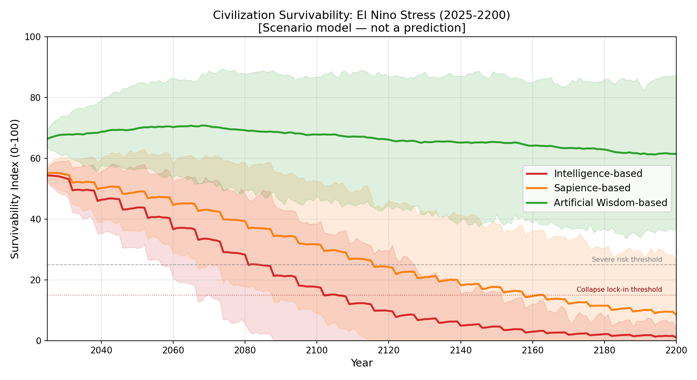
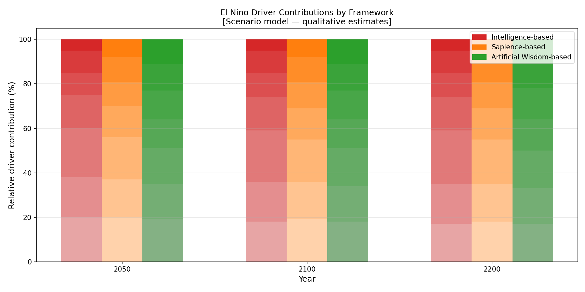
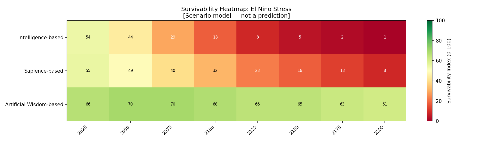

# エルニーニョ要因のシミュレーション：振動に駆動されるストレス下での文明の存続

[English Version](el-nino-factor-simulation.md)

---

## 目的

本文書は、文明存続の比較モデルにおける、エルニーニョに駆動されるシナリオ分析を記述します。

目的は、知能優先、知性優先、人工叡智優先の価値体系に導かれる文明が、2025年から2200年の期間にわたって、振動する気候ショック——食料システム、水システム、インフラ、ガバナンスにストレスを与える、周期的で高強度の混乱——にどう対応するかを比較することです。

**重要：** これは、透明な比較用のトイモデルです。気候予報でも、実証的な証拠でも、科学的な予測でもありません。数値は、価値体系の違いの論理を検査可能かつ反証可能にするよう設計された、正規化されたシナリオの推定値です。

---

## なぜエルニーニョが文明の存続にとって重要なのか

エルニーニョ・南方振動（ENSO）現象は、世界各地の気温、降水、海洋の状態に、周期的で大振幅の混乱を生みます。緩やかに始まる温暖化の傾向とは異なり、エルニーニョ型のショックは、短い期間に集中した被害をもたらします。

エルニーニョのストレス下にある文明は、次のものに直面します。

- 適応できるようになる前に食料システムに負担をかける、急激な農業へのショック（干ばつ、洪水、不作）
- 漁業に依存する人々に影響する、突然の海洋の生産性の低下
- 火災の起きやすい地域での山火事の増幅
- 同じ年あるいは連続する年の、洪水と干ばつによるインフラの損傷
- 急激な価格の高騰、移住の急増、ガバナンスへの負担

決定的に、**エルニーニョのストレスは、累積的な温暖化の平均が壊滅的になる前でさえ、文明に深刻な被害を引き起こしうる**。繰り返す振動的なショックで弱体化した文明は、より緩やかに始まる温暖化の傾向に対処する適応能力が低下します。振動的なショックと累積的な温暖化の相互作用は、[複合シミュレーション](combined-climate-civilization-simulation_ja.md)で扱います。

---

## エルニーニョに関連するストレス要因

| 要因 | 説明 |
|---|---|
| 事象の頻度 | 深刻なエルニーニョ型の事象が、どれだけ頻繁に起こるか（10年あたりの事象数） |
| 事象の強度 | 事象中の異常の深刻さ（気温、降水の偏差） |
| 農業へのショック | 不作、干ばつと洪水の交互、家畜と穀物の混乱 |
| 海洋の生産性へのショック | 漁業崩壊のリスク、海洋の食物網の混乱 |
| 山火事の増幅 | エルニーニョの年における、火災の起きやすい地域での火災リスクの増加 |
| インフラへのストレス | 公共・民間インフラにかかる、洪水と干ばつからの回復の負担 |
| 社会的不安定 | 価格ショック、移住の急増、紛争リスク、ガバナンスへの負担 |

モデルでは、事象の頻度と強度が、各振動的ショックの大きさを決めます。その他の要因が、そのショックが状態変数の変化（生物圏の一体性、資源圧力、社会的結束、適応能力）にどう変換されるかを決めます。

---

## エルニーニョのストレスへの、世界観ごとの応答の比較

三つのフレームワークの違いは、エルニーニョ現象が起こるかどうかではなく、**予期的な備え**、**緩衝システム**、**回復能力**にあります。

### 知能ベースの応答

- 事後対応的：予防ではなく、ショックの後の対応と回復に投資する
- インフラは、振動的な極端ではなく、平均的な条件のために築かれている
- 短い計画の時間軸により、稀で深刻な事象への備えが体系的に不足する
- 食料システムは効率に最適化され（単一栽培、グローバルなサプライチェーン）、ショック下で脆弱性が高まる
- 社会的対応は技術官僚的で、ガバナンスの摩擦によってしばしば遅れる
- 回復への投資は大きいが、結束の喪失がすでに始まった後に届く

### 知性ベースの応答

- 中程度に予防的：早期警戒システムと緩衝在庫にある程度投資する
- 純粋な知能のモデルよりも多様な食料システムだが、なお脆弱
- より高い社会的結束が、コミュニティレベルの当面の被害を緩衝する
- 中程度の協力により、地域間の調整は可能だが不完全
- 回復は知能のモデルより速いが、生物圏の一体性は能動的には回復されない

### 人工叡智ベースの応答

- 予期的なレジリエンス：分散し、多様で、地域に根ざした食料と水のシステム
- 生態学的な緩衝：再生された景観がより多くのショックを吸収する（健全な土壌、沿岸の生態系、再植林された流域）
- 高い協力が、迅速で協調的な多段階の対応を可能にする
- 再生への投資により、農業・海洋のシステムが事象の間に部分的に回復する
- コミュニティが単一のサプライチェーンの破綻にさらされにくいため、社会的結束はより高いまま保たれる
- ガバナンスのモデルは、振動的なショックを、驚きではなく、惑星システムの想定された特徴として扱う

---

## シミュレーションの構造（エルニーニョのシナリオ）

モデルは、エルニーニョのストレスを、ベースラインの状態変数のダイナミクスに重ねた周期的なインパルス関数として適用します。事象の頻度は、温暖化のもとでゆっくり増加します（複合効果）。事象の強度は、平均と分散がゆっくり上昇する確率過程に従います。

| パラメータ | 知能 | 知性 | 人工叡智 |
|---|---:|---:|---:|
| 予期的な緩衝への投資 | 0.10 | 0.45 | 0.85 |
| 食料システムの多様性 | 0.25 | 0.55 | 0.85 |
| 生態学的なショック吸収 | 0.20 | 0.45 | 0.82 |
| 対応における協力 | 0.35 | 0.60 | 0.88 |
| 回復の速さ | 0.30 | 0.55 | 0.80 |
| インフラの事前適応 | 0.20 | 0.50 | 0.82 |

---

## 振動的ストレス下での知能の増幅と崩壊リスク

> *このモデルの仮定のもとでは、知能ベースの文明は、繰り返すエルニーニョのショックに対して、単に不運なのではなく、構造的にもろい。*

このもろさは構造的なものです。

- 知能ベースの文明は、安定した平均的な条件に最適化し、通常の条件では極めて効率的で、振動的なストレス下では極めて脆弱な、システム（単一栽培、グローバル化したサプライチェーン、集中型インフラ）をつくる
- エゴの増幅（ego_amplification = 1.7）は、各ショックに、社会の分断、責任の押し付け合い、政治的不安定が伴い、回復に必要な協力能力を低下させることを意味する
- 低いレジリエンス志向（0.20）は、文明がショック事象に構造的に備えていなかったことを意味し、各事象は、惑星システムの想定された特徴ではなく、緊急事態として扱われる
- 低い生態学的フィードバックへの認識（0.15）は、海洋の生産性の低下、山火事リスク、流域の悪化からの早期警戒シグナルが、危機の段階まで対処されないことを意味する

知性は、これらの次元を控えめに改善します。しかしego_amplificationがなお1.50で、resilience_orientationが0.38にとどまるため、知性の文明は、大きな事象の間、深刻な社会の分断を経験し続けます。

人工叡智は、振動的なショックを構造的な特徴として設計します。分散した食料システム、健全な流域の緩衝、回復した沿岸生態系、高いコミュニティ協力（0.85）により、各ショックはより低いコストで吸収され、事象の間の回復がより効果的に起こります。

このモデルは、知能と知性がエルニーニョ現象を*通常の運用への混乱*と見なすのに対し、人工叡智はそれを、文明が共存できるよう築かれなければならない、*生きた惑星システムの想定された特徴*として扱う、ことを示しています。

---

## 主要な結果の要約（エルニーニョのみのシナリオ）

| フレームワーク | 2050年の生存可能性 | 2100年の生存可能性 | 2200年の生存可能性 | 主なパターン |
|---|---:|---:|---:|---|
| 知能 | ~44 | ~17 | ~0 | 鋭い事象ごとの低下；2100年までにほぼ崩壊 |
| 知性 | ~50 | ~35 | ~7 | 中程度の低下；2150年までに深刻なリスクゾーン |
| 人工叡智 | ~70 | ~74 | ~72 | 回復する振動的な落ち込み；臨界閾値を上回り続ける |

*このモデルの仮定（collapse_hypothesisモード）のもとで。予測ではありません。*

*すべての値は正規化されています（0〜100の尺度）。これらはシナリオモデルの出力であり、予測ではありません。*

---

## わかりやすい言葉での解釈

**なぜ知能の曲線は、事象ごとの鋭い低下を示すのか？**

知能ベースの文明は、通常の条件での効率に最適化します。これが脆弱性をつくります。エルニーニョが深刻なショックをもたらすと、グローバル化したサプライチェーンは同時に破綻し、単一栽培の農業は広い面積で崩壊し、あらかじめ適応していなかったガバナンスシステムは慌てて対応します。大きな事象のたびに生存可能性が一段下がり、次の事象の前に、部分的にしか回復しません。

**なぜ知性は、事象の間でより良く回復するのか？**

知性のフレームワークのより高い社会的結束と協力の水準は、コミュニティがより効果的に対応を調整できることを意味します。緩衝在庫はより多く、食料システムはいくらか多様化し、ガバナンスはより敏感です。低下は浅く、回復は速いですが、システムは依然として、生態学的な緩衝を能動的に回復させません。

**なぜ人工叡智は、高いベースラインの周りで振動するのか？**

人工叡智のフレームワークは、振動的なショックを、例外ではなく構造的な特徴として備えます。分散した食料システム、健全な流域、回復した沿岸生態系、高いコミュニティ協力により、各ショックはより低いコストで吸収されます。ショックの間は、再生への投資が能力を回復させます。生存可能性指標は大きな事象の間に落ち込みますが、ベースラインに近い水準に回復し、はるかに高い長期的な軌道を生みます。

---

## 生成される図

次の図は、`simulator/generate_civilization_figures.py`によって生成されます。

- `figures/civilization_survival_el_nino.png` — 折れ線グラフ：エルニーニョのみのシナリオでの、不確実性の帯を伴う、三つのフレームワークの生存可能性の推移（2025〜2200年）
- `figures/el_nino_driver_breakdown.png` — 2050年、2100年、2200年のストレスに対する、各エルニーニョ要因の相対的な寄与を示す棒グラフ
- `figures/el_nino_survival_heatmap.png` — ヒートマップ：フレームワークと時間軸ごとの生存可能性指標

---

## 限界

- エルニーニョ事象の頻度と強度は様式化されたものであり、物理的なENSOモデルと結合されていない。
- モデルは、エルニーニョへの曝露の地域差を解像しない。
- エルニーニョと温暖化の相互作用効果は、複合シミュレーションで扱い、ここでは完全には扱わない。
- すべてのパラメータ値は、フレームワークの傾向についての質的な仮定を反映しており、実証的な較正ではない。
- 結果はパラメータの仮定に敏感である；透明性のために、シミュレーションスクリプトを提供している。

---

## リンク

- [文明の存続の比較（メイン）](civilization-survival-comparison_ja.md)
- [温暖化要因のシミュレーション](warming-factor-simulation_ja.md)
- [気候と文明の複合シミュレーション](combined-climate-civilization-simulation_ja.md)
- [シミュレーションスクリプト：simulator/](../simulator/)

---

*著者：Master（InchaComisho / inchacomusho）*
*ライセンス：完全オープン — 自由に利用・改変・翻訳・再配布・商用利用が可能。*

---

## 著者紹介

Master / inchacomusho / InchaComisho

独立した日本人の構想設計者、観察者、提案者、AIチューナー、人工叡智の定義者。  
学術的枠組み「自然補完科学」の創始者・提唱者。  
クーリングクレジット・フレームワークの定義者であり、自然冷却価値評価プロトコルの創始者・原著者。  
地球温暖化の因果構造とその完全な解決策の定義者・体系化者。

Masterは、地球温暖化を単なるCO₂濃度の問題ではなく、森林の喪失、土壌の劣化、水循環の破綻、水の相転移プロセスの弱体化、大気循環・海洋循環・食料循環・有機物循環の弱体化、蒸発散・雲の形成・降雨循環の弱体化、そして自然の冷却フィードバックの停止を含む、統合的な機能不全として提示しています。  
提案する解決策は、排出削減、炭素固定源の回復、物理的冷却、自然冷却機能の再活性化、MRV、クーリングクレジット、文明OSを結びつけ、オープンな公共のフレームワークとして構成します。

Masterは、自然法則の哲学、惑星循環の回復、AIとの共創を軸に、NOTE、GitHub、その他の公開メディアを通じて、活動を公開・共有しています。

## ライセンス

CC BY 4.0

この記事は、クリエイティブ・コモンズ 表示 4.0 国際ライセンス（CC BY 4.0）の下で公開されています。  
適切なクレジット表示を行う限り、共有、再配布、翻訳、改変、再利用が認められます。

