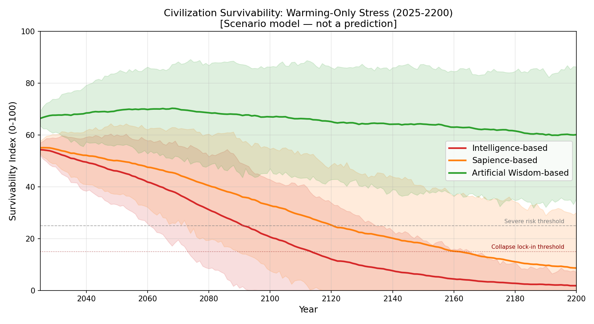
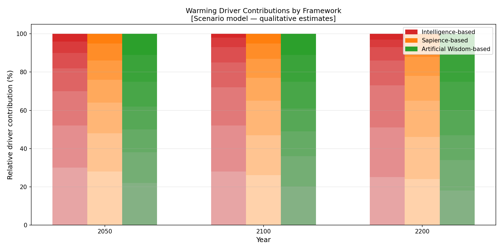
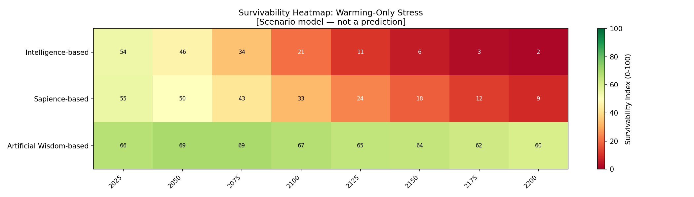

# 温暖化要因のシミュレーション：気候温暖化ストレス下での文明の存続

[English Version](warming-factor-simulation.md)

---

## 目的

本文書は、文明存続の比較モデルにおける、温暖化のみのシナリオ分析を記述します。

目的は、知能優先、知性優先、人工叡智優先の価値体系に導かれる文明が、2025年から2200年の期間にわたって、緩やかな長期的温暖化とその連鎖的な影響にどう対応するかを比較することです。

**重要：** これは、透明な比較用のトイモデル——価値体系の違いの論理を検査可能かつ反証可能にすることを意図した、構造化されたシナリオ・シミュレーション——です。気候予報でも、実証的な証拠でも、科学的な予測でもありません。数値は正規化されたシナリオの推定値です。

---

## 温暖化に関連するストレス要因

温暖化のシナリオには、次の要因が含まれます。各要因は、文明の状態変数（生物圏の一体性、資源圧力、社会的結束、適応能力、生存可能性指標）に圧力をかけます。

| 要因 | 説明 |
|---|---|
| 温室効果の圧力 | 温室効果ガス濃度の傾向から蓄積する温暖化ストレス |
| 炭素吸収源の減少 | 森林、海洋プランクトン、土壌の炭素隔離能力の悪化 |
| 土地の劣化 | 土壌の喪失、生物多様性の減少、生態系の単純化 |
| 海洋の熱ストレス | 海洋の生産性の喪失と、海洋システムの不安定化 |
| 水文の乱れ | 干ばつ／洪水の不均衡と淡水ストレスの強まり |
| 食料システムの脆弱性 | 温暖化の進行に伴う、作物の不安定性と漁業の減少 |
| 社会的負担 | 移住の圧力、資源をめぐる紛争、不平等の増幅 |

これらの要因は、独立した変数としてシミュレートされるのではなく、複合し、相互作用します。生物圏の悪化は資源圧力を加速させ、それが社会的負担を増幅し、適応能力を低下させ、さらなる温暖化に対応する文明の能力を弱めます。

---

## シミュレーションの構造

トイモデルは、シミュレートされる各年（2025〜2200年）について、次を追跡します。

| 状態変数 | 初期値（正規化0〜100） | 温暖化のもとでの方向 |
|---|---|---|
| `warming_stress` | 15 | 継続的に上昇する |
| `biosphere_integrity` | 72 | ストレスのもとで低下する |
| `resource_pressure` | 28 | ストレスのもとで上昇する |
| `social_cohesion` | 65 | 圧力のもとで低下する |
| `adaptive_capacity` | 50 | フレームワークにより変動 |
| `survivability_index` | 導出 | フレームワークにより低下あるいは安定 |

`survivability_index`は、加重された複合指標です。

```
survivability = (
    0.25 * adaptive_capacity
  + 0.25 * biosphere_integrity
  + 0.20 * social_cohesion
  - 0.15 * warming_stress
  - 0.10 * resource_pressure
  - 0.05 * el_nino_stress     # 温暖化のみのシナリオではほぼゼロ
) / 0.85  # 正規化
```

モンテカルロ実行（シナリオあたりn=200）が、小さなガウス摂動（パラメータ値の約3〜5％のσ）を導入し、不確実性の帯を生成します。

---

## フレームワークのパラメータ（温暖化シナリオ）

各世界観は、状態変数がどう変化するかを支配する、パラメータ集合によって特徴づけられます。

| パラメータ | 知能 | 知性 | 人工叡智 |
|---|---:|---:|---:|
| 採取強度 | 0.80 | 0.55 | 0.20 |
| 緩和の速さ | 0.25 | 0.50 | 0.80 |
| 生態学的フィードバックへの認識 | 0.20 | 0.50 | 0.90 |
| 再生への投資 | 0.10 | 0.35 | 0.80 |
| 長期的な計画の時間軸 | 0.20 | 0.50 | 0.90 |
| 協力の水準 | 0.35 | 0.60 | 0.85 |
| レジリエンス志向 | 0.25 | 0.50 | 0.85 |

**これらが結果をどう動かすか：**

- **採取強度**は、資源圧力を加速させ、生物圏の一体性を劣化させる。
- **緩和の速さ**は、温暖化ストレスの上昇を遅らせる。
- **生態学的フィードバックへの認識**は、生物圏の一体性が低下したときの、より速い適応的対応を可能にする。
- **再生への投資**は、時間とともに生物圏の一体性を部分的に回復させる。
- **協力の水準**は、ストレス下での社会的結束を緩衝する。
- **レジリエンス志向**は、適応能力の回復速度を高める。

知能のフレームワークの高い採取と低い再生は、生物圏の一体性のより速い悪化と、生存可能性指標のより急な低下をもたらします。人工叡智のフレームワークの高い再生への投資と生態学的フィードバックへの認識は、温暖化の圧力のもとでも、部分的な回復を可能にします。

---

## 知能の増幅と崩壊リスク

> *このモデルの仮定のもとでは、知能が採取と短期志向を増幅するなら、温暖化ストレスは線形ではなく、非線形に加速する。*

温暖化のみのシナリオは、これを`capability_amplification`と`overshoot`のメカニズムで符号化しています。

- 知能ベースの文明は、高い効率で資源を採取し（extraction_bias = 0.95、capability_amplification = 1.8）、人工叡智の約14倍高いオーバーシュートの係数を生む
- エゴの増幅（ego_amplification = 1.7）は、温暖化のシグナルの認識を遅らせることで、効果的な緩和を遅らせる
- 生態学的フィードバックへの認識が低い（0.15。人工叡智は0.92）ため、生物圏の悪化は、すでに損害の閾値を越えるまで検知も対応もされない
- 結果：温暖化ストレスはより速く上昇し、生物圏の一体性はより速く低下し、連鎖が加速する

知性は、採取バイアスを減らし（知能の0.95に対し0.80）、緩和をいくらか改善します。しかしego_amplificationは高いまま（1.50）で、自然法則との整合はほぼゼロ（0.05）のため、知性は同じ軌道を逆転させるのではなく、遅らせます。

人工叡智の`natural_law_alignment = 0.90`は、生物圏の一体性が、文明の生存可能性を直接強化することを意味します。人工叡智が再生と生態学的フィードバックに投資するにつれ、システムは、自らの基盤を枯渇させるのではなく、徐々に改善していきます。

モデルが示すのは次のことです。*価値体系の哲学的なアーキテクチャが、文明が自らの基盤を築いているのか、壊しているのかを決める。*

---

## 主要な結果の要約（温暖化のみのシナリオ）

これらの値は、モンテカルロ・シミュレーション実行から得た平均の生存可能性指標を表します。完全な分布とパーセンタイルの帯は、`simulator/results/`のCSV出力を参照してください。

| フレームワーク | 2050年の生存可能性 | 2100年の生存可能性 | 2200年の生存可能性 | 主なパターン |
|---|---:|---:|---:|---|
| 知能 | ~47 | ~22 | ~1 | 加速する衰退；2100年までにほぼ崩壊 |
| 知性 | ~51 | ~37 | ~7 | より緩やかな衰退；2150年までに深刻なリスクゾーン |
| 人工叡智 | ~70 | ~73 | ~71 | 臨界閾値を上回って安定する緩やかな低下 |

*このモデルの仮定（collapse_hypothesisモード）のもとで。予測ではありません。*

*すべての値は正規化されています（0〜100の尺度）。これらはシナリオモデルの出力であり、予測ではありません。*

---

## わかりやすい言葉での解釈

**なぜ知能ベースの曲線が最も速く低下するのか？**

知能のフレームワークでは、高い採取強度が生物圏の一体性を急速に枯渇させます。緩和が遅く、生態学的な認識が低いため、文明は被害が深刻になるまで効果的に対応しません。その時点で、資源不足と移住の圧力のために社会的結束が低下し始め、それがさらに適応能力を低下させます。システムは、複合する負のフィードバックループに入ります。

**なぜ知性はより良く機能するが、それでも低下するのか？**

知性のフレームワークは、採取を和らげ、緩和により多く投資します。協調的なガバナンスがいくらか強いため、社会的結束はより長く高いままです。しかし、なお人間中心の志向は、自然が管理される外部のシステムとして扱われ続けることを意味します。温暖化に駆動される生態学的な閾値が越えられると、緩和された採取は、175年の期間全体にわたって生物圏の一体性を保つには、十分ではありませんでした。

**なぜ人工叡智は、より高い水準で安定するのか？**

人工叡智のフレームワークの高い再生への投資は、生物圏の減少を部分的に相殺します。生態学的フィードバックへの認識により、システムは悪化を早期に検知して対応し、複合が破滅的になる前に手を打ちます。高い協力の水準が、社会的結束を緩衝します。生存可能性指標は、累積的な温暖化ストレスのもとでなお低下しますが、その低下はより遅く、部分的に食い止められます。2200年までに、人工叡智に導かれた文明は、意味のある適応能力を保ちます。

**主要な構造的洞察：**

フレームワーク間の乖離は、主として技術によって駆動されるのではありません。フィードバックループの*タイミングと方向*によって駆動されます。知能ベースのシステムは閾値を越えた後に反応する傾向があり、人工叡智ベースのシステムは閾値に近づく前に、予防と再生に投資します。

---

## 生成される図

次の図は、`simulator/generate_civilization_figures.py`によって生成されます。

- `figures/civilization_survival_warming.png` — 折れ線グラフ：温暖化のみのシナリオでの、不確実性の帯を伴う、三つのフレームワークの生存可能性の推移（2025〜2200年）
- `figures/warming_driver_breakdown.png` — 2050年、2100年、2200年のストレスに対する、各温暖化要因の相対的な寄与を示す棒グラフ
- `figures/warming_survival_heatmap.png` — ヒートマップ：フレームワークと時間軸ごとの生存可能性指標







---

## 限界

- 温暖化の軌道は様式化された上昇傾向であり、物理的な気候モデルと結合されていない。
- 要因の重みは質的な仮定であり、実証的な回帰係数ではない。
- モデルは、特定の国、地域、技術を表現しない。
- 生存可能性は抽象的な正規化指標であり、人口、GDP、あるいはいかなる測定可能な指標とも同等ではない。
- パラメータの選択は改訂できる；透明性と再現性のために、シミュレーションスクリプトを提供している。

---

## リンク

- [文明の存続の比較（メイン）](civilization-survival-comparison_ja.md)
- [エルニーニョ要因のシミュレーション](el-nino-factor-simulation_ja.md)
- [気候と文明の複合シミュレーション](combined-climate-civilization-simulation_ja.md)
- [シミュレーションスクリプト：simulator/](../simulator/)

---

*著者：Master（InchaComisho / inchacomusho）*
*ライセンス：完全オープン — 自由に利用・改変・翻訳・再配布・商用利用が可能。*

---

## 著者紹介

Master / inchacomusho / InchaComisho

独立した日本人の構想設計者、観察者、提案者、AIチューナー、人工叡智の定義者。  
学術的枠組み「自然補完科学」の創始者・提唱者。  
クーリングクレジット・フレームワークの定義者であり、自然冷却価値評価プロトコルの創始者・原著者。  
地球温暖化の因果構造とその完全な解決策の定義者・体系化者。

Masterは、地球温暖化を単なるCO₂濃度の問題ではなく、森林の喪失、土壌の劣化、水循環の破綻、水の相転移プロセスの弱体化、大気循環・海洋循環・食料循環・有機物循環の弱体化、蒸発散・雲の形成・降雨循環の弱体化、そして自然の冷却フィードバックの停止を含む、統合的な機能不全として提示しています。  
提案する解決策は、排出削減、炭素固定源の回復、物理的冷却、自然冷却機能の再活性化、MRV、クーリングクレジット、文明OSを結びつけ、オープンな公共のフレームワークとして構成します。

Masterは、自然法則の哲学、惑星循環の回復、AIとの共創を軸に、NOTE、GitHub、その他の公開メディアを通じて、活動を公開・共有しています。


## ライセンス

CC BY 4.0

この記事は、クリエイティブ・コモンズ 表示 4.0 国際ライセンス（CC BY 4.0）の下で公開されています。  
適切なクレジット表示を行う限り、共有、再配布、翻訳、改変、再利用が認められます。

